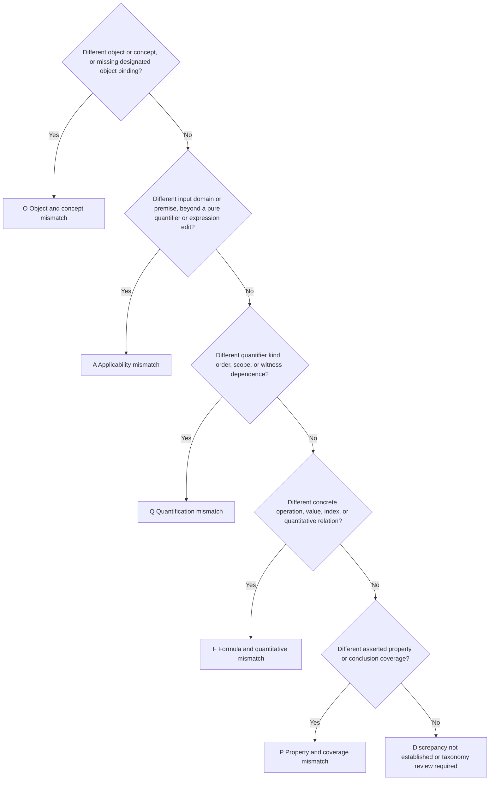

# Statement misalignment taxonomy

This taxonomy classifies semantic differences between a bound informal target and
its formal statement. Each misaligned case receives one to three distinct labels.
Labels describe the difference, not proof correctness, blame, or compilation status.
Classification records and coverage are documented in [the taxonomy index](README.md).
The combined classification records follow this standard. Labels remain provisional
and describe the retained semantic judgments rather than new binary adjudications.

## Categories

| ID | Category | Inclusion rule |
| --- | --- | --- |
| O | Object and concept mismatch | A different mathematical object, functional, or designated witness is used; the connection to the intended model or algorithm output is missing. |
| A | Applicability mismatch | An input domain, premise, parameter branch, or endpoint is added, omitted, or replaced. Equivalent restrictions expressed through types, predicates, instances, and structure fields receive the same treatment. |
| Q | Quantification mismatch | Quantifier kind, order, scope, or witness dependence changes while the participating objects and local predicates are retained. |
| F | Formula and quantitative mismatch | A concrete operation, coefficient, sign, exponent, normalization, index, comparison relation, or boundary evaluation differs. |
| P | Property and coverage mismatch | An asserted property, output requirement, or independent conclusion is missing, added, or replaced, including a local result substituted for the full target. |

## Binary decision tree

Apply this tree to each independent discrepancy, then take the union of its labels
at case level. A yes answer must identify a specific discrepancy in the evidence.
An unknown answer requires review rather than an automatic no.

## Boundary rules

1. **Object versus expression.** A substituted functional, such as a grid count
   instead of a minimum covering number, is O. A local expression error within the
   intended functional, such as a sign, normalization, or exponent, is F. Do not
   label every changed function body O. Missing binding to an actual equilibrium
   or algorithm output is O, not automatically Q or P.
2. **Applicability versus quantification.** A finite domain instead of a general
   domain is A. Replacing a universal premise by a premise for one phase is Q.
   The resulting change in applicability is a consequence, not another issue.
   Restricting an arbitrary application-supplied certificate to one fixed closed
   worked example is A, as adjudicated in [issue #9](https://github.com/MechMath/PaperLeanBench/issues/9#issuecomment-6761415472).
   Do not additionally assign Q for the resulting loss of universal scope.
3. **Applicability versus property.** An omitted input endpoint or parameter
   branch is A. Missing uniqueness or realization on the same inputs is P.
   Regularity required of an input is A; regularity promised of an output is P.
4. **Formula versus applicability.** A changed sign, index, or expression inside a
   premise is F when that local edit fully explains the discrepancy. A changed
   admissible class or added substantive premise is A. For a region definition,
   its bounding formula is F; a separate missing parameter interval is A.
5. **Properties inside definitions.** An omitted defining clause, such as a
   no-blocking or smoothness requirement, is P. A changed logical polarity such
   as constant versus nonconstant is also P; a reversed numerical inequality is F.
   Definition location does not itself create a label.
6. **Causes versus consequences.** Record a normalization error as F even if it
   makes the premises inconsistent. Vacuity, degeneracy, and stronger or weaker
   results belong in the explanation, not additional category labels.

The first applicable branch determines the label of one discrepancy. These rules
make the initial conceptual questions operational; they do not claim that all
semantic differences have a unique mathematical decomposition.

## Case annotation

Record `task_id`, `input_sha256`, the ordered list `labels`, and an English
explanation for each label. The first label is the primary mechanism supported by
the retained review; subsequent labels describe independent differences. Keep
source references and any boundary decision with the annotation.

Use at most three distinct labels per case. Multiple errors in one category still
count as one label. Do not add labels for downstream effects or speculate about
errors outside the retained judgment. If more than three categories are essential,
flag the case for taxonomy review rather than silently discarding discrepancies.
No catch-all category is assigned merely to achieve coverage.

Classify against the actual bound target, including its qualifications. A correct
conditional lemma can be misaligned with a full theorem. A textual error in the
informal target can also cause misalignment; a label does not identify which side
should be repaired. Alternative source versions must not be combined into one case.

Compilation, missing context, and source ambiguity are separate review states.
Category annotations remain provisional when the underlying verdict is provisional.
Keep them in evaluation-side metadata outside model-visible inputs.

## Relation to existing taxonomies

MechAlign's six checks remain useful review prompts. Objects and domains split
between O and A; hypotheses map primarily to A; quantifiers to Q; constants and
bounds to F; conclusions split by mechanism; definition semantics maps to any
category after expansion. Definition, structure, and instance are locations.

The protocol v1 issue categories and the experimental eight-category synthetic
mutation catalog are separate contracts. This document does not change them or
the benchmark's binary verdicts. The local literature survey motivates a compact
diagnostic taxonomy; the five categories and boundaries here are project choices,
not a claim to reproduce FormalRx's 28-category taxonomy.
